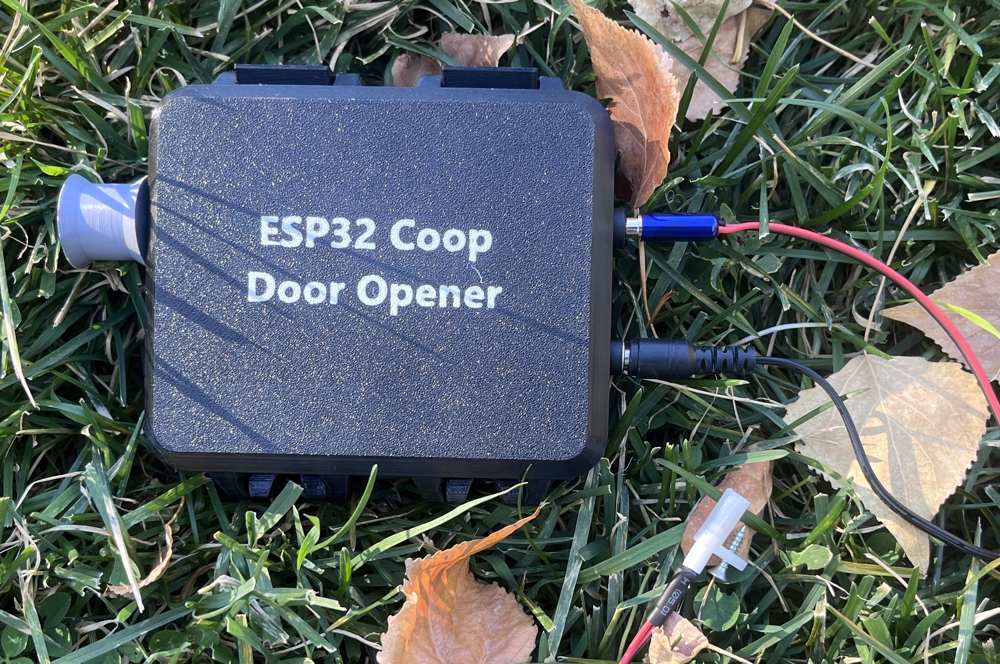
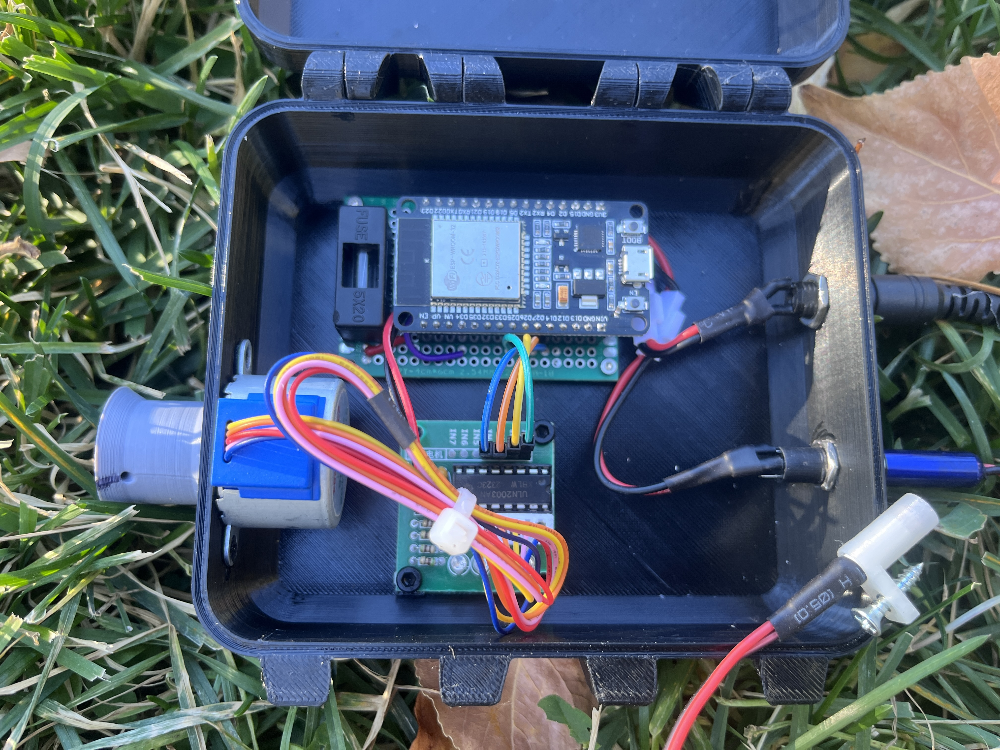
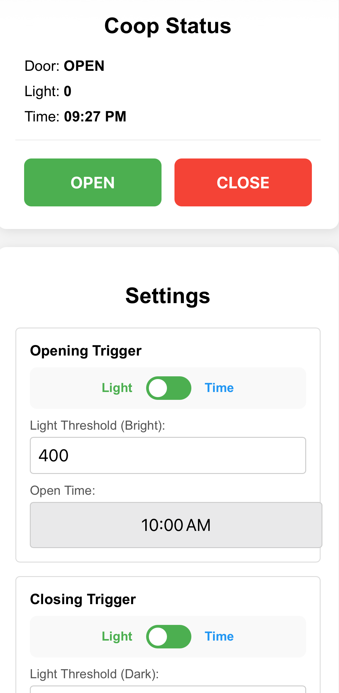
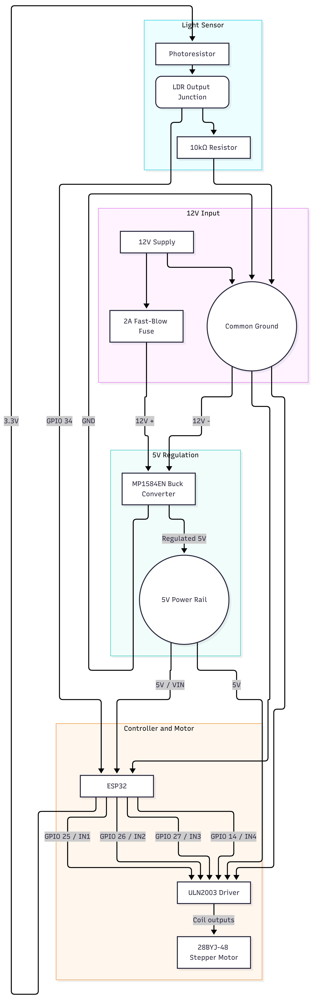

# ESP32 Automated Chicken Coop Door Controller

WiFi-enabled automated chicken coop door controller built on the ESP32. This project features a custom web interface, allowing you to control the door manually or set it to run automatically using either an environmental light sensor (photoresistor) or NTP-synchronized clock times with no app to install. It utilizes an edge-trigger state machine and non-volatile flash memory to ensure the door never loses its state, even during power outages. Inspired by [ESP32 COOP DOOR](https://github.com/ESP32-COOP).

## Key Features

* **Dual Auto Modes:** Trigger the door using ambient light thresholds or specific times of day (synced via NTP).

* **Web Dashboard:** Accessible via `[http://coop.local](http://coop.local)` to view live status, open/close the door, and adjust settings without rewriting code. Note: only available on your local network, not while you're away from the farm.

* **Power-Resilient Memory:** Saves physical door position and cycle states to the ESP32's flash memory. Recovers perfectly after power failures.

* **Edge-Trigger Logic:** Prevents rapid toggling. Once the door enters the "Day" or "Night" cycle, it waits for a sustained 30-second environmental shift before transitioning again.

* **Web-Based Calibration:** Adjust stepper motor revolutions dynamically through the UI.

## Hardware Requirements

* **Microcontroller:** DOIT ESP32 DEVKIT V1 ([AITRIP ESP-WROOM-32 Development Board 2.4GHz Dual-Mode WiFi + Bluetooth Dual Cores Microcontroller Processor Integrated with Antenna RF AMP Filter AP STA](https://a.co/d/0fGKghaw))

* **Motor:** [28BYJ-48 Stepper Motor with ULN2003 Driver Board](https://a.co/d/08mGWwND) (attach to box by deforming printed studs with heat, I used a soldering iron on a low setting), 2- 3Mx4 screws for ULN2003 Driver

* **Power:** [12V Power Supply](https://a.co/d/0hwFqWwe) & [MP1584EN Buck Converter](https://a.co/d/0iDOPItW) (can take 5v-28v input) via [5.5mm x 2.1mm socket](https://a.co/d/0gPqByIp)

* **Sensor:** [Photoresistor (LDR)](https://a.co/d/0f2u4yJo) & 10kΩ Resistor via [3.5mm headphone connector](https://a.co/d/09H40uua) with 22g wire

* **Safety:** [1A to 3A Fast-Blow Fuse](https://a.co/d/03rZq3FY) (System draws <1A under normal load)

* **3D Print:** [Enclosure (add screw holes to bottom or top as desired), Spool, and Photoresistor holder](https://www.thingiverse.com/thing:7421323).

* **Other:** Kite string, License Plates (pop-riveted together) for door, [1/4" aluminum trim channel](https://www.homedepot.com/p/Everbilt-1-4-in-Wide-Inside-x-4-ft-Aluminum-Trim-Channel-Metal-Stock-6530/340452574) for the door to slide in, [Prototype Boards and Headder Connections](https://a.co/d/074FiDg6), 2- 2Mx4 screws for Prototype Board

## Wiring & Schematic

This project uses a "Star Power" topology to safely step down a 12V battery/supply to a stable 5V for the logic board and motor driver, protecting the ESP32 from voltage spikes.

### Pin Mapping

| ESP32 Pin | Component Connection | Notes |
| --- | --- | --- |
| **VIN** | MP1584EN 5V OUT (+) | Ensure buck converter is tuned to 5.0V *before* connecting. Secure set screw with hot glue or nail polish after tuning.

 |
| **GND** | Common Ground | Connects to Buck OUT (-), ULN2003 (-), and the 10kΩ resistor.

 |
| **GPIO 25** | ULN2003 IN1 | Motor Phase 1

 |
| **GPIO 26** | ULN2003 IN2 | Motor Phase 2

 |
| **GPIO 27** | ULN2003 IN3 | Motor Phase 3

 |
| **GPIO 14** | ULN2003 IN4 | Motor Phase 4

 |
| **GPIO 34** | Photoresistor Junction | Wired in a pull-down configuration with a 10kΩ resistor to GND and 3.3V to the LDR.

 |

## Software Setup

1. **IDE Preparation:** Install the Arduino IDE.
2. **ESP32 Core:** Add the ESP32 board manager URL and install **esp32 by Espressif Systems**.
* *Critical Note:* This specific ESP32 board requires **v2.0.17** of the ESP32 core. Newer versions (v3.0.0+) may cause compatibility issues with certain libraries. Select "DOIT ESP32 DEVKIT V1" as your board. Other boards may require a different version from the Board Manager.

3. **Libraries:** The project uses standard built-in libraries:

* `WiFi.h`
* `WebServer.h`
* `ESPmDNS.h`
* `Stepper.h`
* `time.h`
* `Preferences.h`

4. **Configuration:**
* Open the `.ino` file and update `ssid` and `password` with your local WiFi credentials.

* The timezone is pre-configured for Mountain Time (`MST7MDT`). Update the `tzInfo` variable if you are in a different timezone.

## Usage & Interface

1. **Power On:** Once powered, the ESP32 will connect to your WiFi and establish a local web server.

2. **Access Dashboard:** Open a browser on a device connected to the same network and navigate to `[http://coop.local](http://coop.local)`. If mDNS is not supported by your device, check the Arduino Serial Monitor (115200 baud) for the assigned IP address.

3. **Configuration:**
* **Toggle Switches:** Select between Light or Time-based triggers for opening and closing.

* **Light Thresholds:** Default is 400 for Bright (Open) and 1 for Dark (Close).

* **Time Presets:** Default is 7am (7) for Open and 8pm (20) for Close.

* **Motor Calibration:** Enter the number of revolutions required to fully open/close your specific door design. Preset to 5.

* Click **Save Settings** to write these values permanently to the ESP32's flash memory.